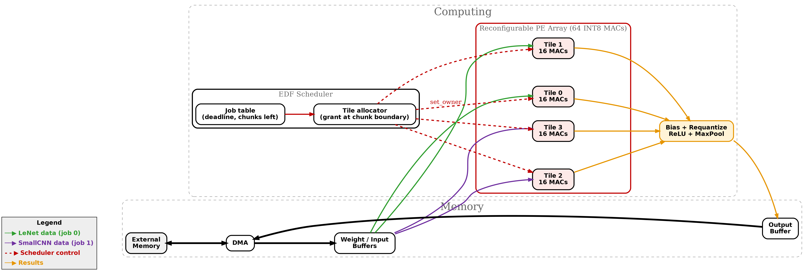

# Deadline-Aware Multi-Network CNN Accelerator on FPGA

A small, fully INT8 CNN inference accelerator written in Verilog. A **64-MAC processing-element (PE) array**, split into four 16-MAC tiles, is **shared between two CNNs running at the same time**: LeNet-5 (MNIST) and a 3-conv SmallCNN (CIFAR-10). An **Earliest-Deadline-First (EDF) scheduler** re-assigns tiles between the two networks at chunk boundaries, so a latency-critical network can meet its deadline without leaving tiles idle.

The project covers the whole flow: PyTorch training → INT8 quantization → golden-vector generation → RTL (tile, PE array, scheduler, multi-network top) → bit-exact simulation against PyTorch → Yosys synthesis for Xilinx 7-series.



---

## Highlights

- **INT8 datapath, bit-exact with PyTorch.** Every tile output in simulation is compared against an integer reference computed from the quantized network.
- **Reconfigurable PE array.** 4 tiles × 16 INT8 MACs; each tile carries an owner tag that can only change while the tile is idle, so a reassignment can never corrupt an in-flight accumulation.
- **Hardware EDF scheduler.** Two jobs (LeNet = job 0, SmallCNN = job 1) arrive periodically with different deadlines. The scheduler grants free tiles to the job with the earliest deadline, re-deciding only at chunk boundaries.
- **Static vs. dynamic comparison.** Both the Python model and the RTL scheduler support a static 2+2 tile split as a baseline.
- **Synthesizable for Xilinx 7-series** (64 DSP48E1 for the PE array, 72 for the full multi-network top).

---

## Architecture

### Compute tile — `rtl/pe_array/tile.v`

A 3-stage pipelined dot-product unit that consumes one beat (16 INT8 activations + 16 INT8 weights) per cycle:

| Stage | Operation |
|-------|-----------|
| 1 | 16 signed 8×8 multiplies → 16-bit products |
| 2 | 16-input adder tree → 20-bit partial sum |
| 3 | 32-bit accumulator |

`in_first` clears the accumulator for a new output and `in_last` emits the finished sum on `out_sum` with `out_valid`. An output that needs *K* inputs takes ⌈K/16⌉ beats (zero-padded to a multiple of 16).

### PE array — `rtl/pe_array/pe_array.v`

Four tiles plus a per-tile 2-bit **owner** register and an `idle` flag (derived from `in_valid` and a 3-deep in-flight pipe). A `set_owner` request is honored only when the tile is idle.

`rtl/pe_array/mac.v` is a standalone single-MAC reference unit (not used by the tile).

### Scheduler — `rtl/scheduler/scheduler.v`

Strict-EDF allocator for the two jobs.

- Each network's layers are cut into **chunks of up to 8192 MACs** (`scripts/gen_chunks.py`); the number of 16-MAC beats per chunk lives in `rtl/scheduler/chunks_*.mem` (37 chunks for LeNet, 344 for SmallCNN).
- When a job finishes a chunk it releases its tiles. Free tiles are then granted to the waiting job with the earliest deadline (`dl0 <= dl1`).
- A grant takes effect one cycle after the decision. Remaining work shrinks by `granted_tiles` beats per cycle.
- Tracks per-job latency, deadline misses (`miss`), and dropped arrivals (`drop0/drop1`) if a new frame arrives while the previous one is still running.
- Parameter `STATIC0 = k` switches to a static split (job 0 owns *k* tiles, job 1 the rest).

### Multi-network top — `rtl/top/multi_top.v`

The synthesizable datapath. It dispatches work **per output element** rather than per layer: whenever a tile finishes (or is about to finish) an output, it picks the next output from LeNet layer 1 (job A) or SmallCNN layer 2 (job B) using the same EDF rule. It then:

1. drives `m_job` / `m_addr` to an external activation/weight memory (expects **1-cycle synchronous read**),
2. feeds the returned 128-bit words to the tile,
3. tags each result with `{job, output index}` through a small per-tile FIFO and presents it on `res_valid / res_tag / res_val`.

`SPLIT = 0` is dynamic EDF; `SPLIT = k` dedicates tiles `< k` to job A and the rest to job B (the static baseline).

`rtl/top/multi_ctrl.v` is the **behavioral** (non-synthesizable) version of the same controller that holds the memories internally; it is used as the first-pass functional model.

### What is and isn't in RTL

The diagram shows the intended full system. The current RTL implements the **EDF scheduler, PE array/tiles and dispatcher**. The DMA, on-chip weight/input buffers, and the bias + requantize + ReLU + max-pool post-processing stage are *not* implemented in Verilog; those steps are done in the Python quantization flow, and the multi-network top talks to memory through plain ports.

---

## Repository layout

```
.
├── models/            PyTorch models (nets.py) and training + INT8 weight export (train.py)
├── quant/             Exported INT8 weights (.npy, .mem), per-layer scales, float checkpoints
│   ├── lenet/
│   └── smallcnn/
├── scripts/           Quantized inference, golden-vector and schedule generation
│   ├── count_macs.py      MACs per layer / per inference
│   ├── int8_lenet.py      Full-integer LeNet-5 inference + test vectors (tb/L*_*.mem)
│   ├── int8_smallcnn.py   Full-integer SmallCNN inference + test vectors (tb/S*_*.mem)
│   ├── gen_conv1.py       LeNet conv1 vectors (tb/conv1_*.mem)
│   ├── gen_chunks.py      Chunk tables for the scheduler (rtl/scheduler/chunks_*.mem)
│   └── sched_sim.py       Cycle-level Python model of static / dynamic / EDF scheduling
├── rtl/
│   ├── pe_array/      mac.v, tile.v, pe_array.v
│   ├── scheduler/     scheduler.v, chunks_*.mem
│   └── top/           multi_top.v (synthesizable), multi_ctrl.v (behavioral)
├── tb/                Testbenches and .mem vectors / layer configs
├── results/           Yosys logs/stats and architecture diagram
└── docs/              architecture.dot (Graphviz source of the diagram)
```

---

## Networks

| | LeNet-5 | SmallCNN |
|---|---|---|
| Dataset | MNIST (1×28×28) | CIFAR-10 (3×32×32) |
| Layers | conv 5×5 (6) → pool → conv 5×5 (16) → pool → FC 256-120-84-10 | 3 × [conv 3×3 → ReLU → pool] (16, 32, 64) → FC 1024-10 |
| MACs / layer | 86,400 · 153,600 · 30,720 · 10,080 · 840 | 442,368 · 1,179,648 · 1,179,648 · 10,240 |
| Chunks (8192 MACs) | 37 | 344 |
| Ideal 4-tile cycles | ≈ 4,401 | ≈ 43,936 |

**Quantization.** Symmetric per-layer INT8 weights (scale = max|w| / 127); INT8 activations in 0..127 after ReLU; 32-bit accumulation; fixed-point requantization with a 16-bit multiplier (`>> 16`, round-to-nearest) calibrated on training samples. `int8_*.py` prints float vs. full-integer accuracy on the first 2000 test images.

---

## Getting started

### Prerequisites

- Python 3 with `torch`, `torchvision`, `numpy`
- [Icarus Verilog](https://github.com/steveicarus/iverilog) (`iverilog`, `vvp`) for simulation
- [Yosys](https://github.com/YosysHQ/yosys) (optional, for synthesis stats)
- Graphviz (optional, to re-render the diagram)

### 1. Train and export INT8 weights

`train.py` uses relative paths (`../data`, `../quant`), so run it from `models/`. Datasets are downloaded automatically.

```bash
cd models
python train.py lenet 5
python train.py smallcnn 10
cd ..
```

### 2. Generate golden vectors and scheduler tables

`int8_*.py` read the datasets with `download=False`, so run step 1 first (it downloads them into `data/`). Run everything from the repository root.

```bash
python scripts/count_macs.py
python scripts/int8_lenet.py        # writes tb/L0..L4_{a,w,exp}.mem and tb/layers.cfg
python scripts/int8_smallcnn.py     # writes tb/S0..S3_{a,w,exp}.mem and tb/layers_smallcnn.cfg
python scripts/gen_conv1.py         # writes tb/conv1_{a,w,exp}.mem
python scripts/gen_chunks.py        # writes rtl/scheduler/chunks_*.mem
```

The generated `.mem` files are already checked in, so you can skip straight to simulation.

### 3. Simulate

Run from the **repository root**: the testbenches load `tb/*.mem` and `rtl/scheduler/*.mem` by relative path.

```bash
# Single-tile checks
iverilog -o tile_sim  rtl/pe_array/tile.v tb/tile_tb.v           && vvp tile_sim     # random vectors
iverilog -o conv1_sim rtl/pe_array/tile.v tb/conv1_tb.v          && vvp conv1_sim    # 3456 LeNet conv1 outputs vs PyTorch
iverilog -o pe_sim    rtl/pe_array/pe_array.v rtl/pe_array/tile.v tb/pe_array_tb.v && vvp pe_sim  # 4 tiles + owner tags

# Any layer through one tile, e.g. LeNet layer 1 (1024 outputs, 10 beats each)
iverilog -o layer_sim rtl/pe_array/tile.v tb/layer_tb.v
vvp layer_sim +NOUT=1024 +BEATS=10 +FA=tb/L1_a.mem +FW=tb/L1_w.mem +FE=tb/L1_exp.mem

# Two networks sharing the array
iverilog -o multi_sim rtl/pe_array/tile.v rtl/top/multi_ctrl.v tb/multi_tb.v       && vvp multi_sim  # behavioral
iverilog -o mt_sim    rtl/pe_array/tile.v rtl/top/multi_top.v tb/multi_top_tb.v    && vvp mt_sim     # synthesizable top
# static split (2 tiles / 2 tiles) instead of dynamic EDF:
iverilog -Pmulti_top_tb.SPLIT=2 -o mt_sim rtl/pe_array/tile.v rtl/top/multi_top.v tb/multi_top_tb.v && vvp mt_sim

# RTL scheduler (EDF, or static with -Pscheduler_tb.S0=2)
iverilog -o sched_sim rtl/scheduler/scheduler.v tb/scheduler_tb.v && vvp sched_sim
```

The multi-network testbenches check that all 1,024 LeNet-layer-1 and 256 SmallCNN-layer-2 outputs arrive bit-exact, exactly once, and report latency against the configured deadlines.

### 4. Synthesize (Xilinx 7-series, Yosys)

```bash
yosys -p "read_verilog rtl/pe_array/tile.v rtl/top/multi_top.v; synth_xilinx -top multi_top -flatten; tee -o results/multi_top_stat.txt stat"
```

### 5. Python scheduling model

```bash
python scripts/sched_sim.py
```

---

## Results

### Scheduling policies (`scripts/sched_sim.py`)

Workload: 33 LeNet frames (period 12,000 cycles, deadline 6,000) running alongside 4 SmallCNN frames (period 100,000, deadline 150,000) on 4 tiles × 16 MACs.

| Policy | Makespan (cycles) | PE utilization | LeNet avg / max latency | LeNet deadline misses | SmallCNN deadline misses |
|---|---|---|---|---|---|
| Static (2 + 2 tiles) | 392,960 | 81.7 % | 8,960 / 8,960 | **33 / 33** | 0 / 4 |
| Dynamic (non-EDF) | 388,820 | 82.5 % | 5,962 / 6,320 | **26 / 33** | 0 / 4 |
| **EDF** | 388,820 | 82.5 % | 4,871 / 4,940 | **0 / 33** | 0 / 4 |

EDF meets every deadline for both networks, while a fixed split cannot give LeNet enough tiles to hit its 6,000-cycle deadline. EDF also improves utilization slightly because idle tiles are handed to whichever job is waiting.

### FPGA resource estimate (Yosys `synth_xilinx`, from `results/`)

| Design | DSP48E1 | FDRE (FF) | LUTs | CARRY4 |
|---|---|---|---|---|
| `tile` (16 MACs) | 16 | 71 | 35 | 8 |
| `pe_array` (4 tiles) | 64 | 296 | 148 | 32 |
| `multi_top` (full dispatcher) | 72 | 558 | 406 | 100 |

The large IBUF/OBUF counts in these reports are because the modules were synthesized out-of-context with memory and result buses as top-level ports. They are not logic cost. These are pre-place-and-route estimates; no timing or Fmax numbers are included.

---

## Verification status

| Test | What it proves |
|---|---|
| `tile_tb` | Tile matches a software dot product on 20 random 4-beat outputs |
| `conv1_tb` | 3,456 LeNet conv1 outputs match PyTorch `conv2d` |
| `layer_tb` | Any dumped layer (LeNet L0–L4, SmallCNN S0–S3) matches the integer reference |
| `pe_array_tb` | 4 tiles compute independently; owner changes are rejected while a tile is busy |
| `multi_tb` / `multi_top_tb` | 1,280 outputs from two networks sharing the array are bit-exact, with deadline accounting |
| `scheduler_tb` | RTL EDF/static scheduler latency and deadline-miss statistics |

---

## Limitations and future work

- `multi_top` dispatches one layer of each network (LeNet L1, SmallCNN S2) as a representative workload, not a complete end-to-end inference. The scheduler operates on whole-network chunk tables.
- Bias, requantization, ReLU and max-pool are not yet in hardware (they are modeled in Python).
- DMA and on-chip buffering are not implemented; memories are external ports and the testbench models them.
- Integration of the chunk-level `scheduler` with the per-output dispatcher in `multi_top` (they currently use the same EDF policy at different granularities).
- Place-and-route, timing closure and on-board bring-up.

---

## Tooling note

The committed binaries at the repository root (`*_sim`, `*.out`) are `vvp` outputs from earlier runs. They can be deleted and rebuilt with the commands above.
