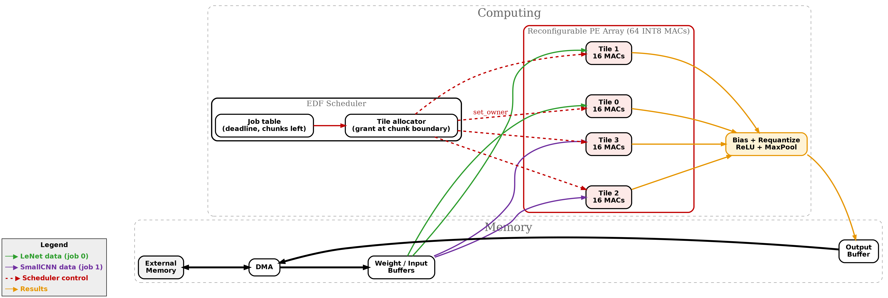

# Deadline-Aware Multi-Network CNN Accelerator on FPGA

**A Verilog-based, INT8 CNN accelerator that shares a 64-MAC processing-element array between LeNet-5 and SmallCNN using deadline-aware scheduling.**

The project investigates whether dynamically allocating FPGA compute tiles according to **Earliest-Deadline-First (EDF)** priorities can improve deadline satisfaction compared with fixed tile partitioning. The repository includes PyTorch models, quantization scripts, integer golden vectors, synthesizable RTL, testbenches, a cycle-level scheduling model, and Xilinx 7-series synthesis reports.

> **Implementation scope:** The full-network accuracy figures are measured in software. The synthesizable `multi_top` validates **concurrent representative CNN layers** (LeNet layer L1 and SmallCNN layer S2), not a complete end-to-end implementation of both CNNs on the FPGA. The standalone chunk-level scheduler and the per-output dispatcher use similar EDF priority rules but are not the same integrated controller.

## Project at a glance

| Item | Description |
|---|---|
| Target | Xilinx Artix-7 XC7A100T (Nexys 4 target) |
| HDL | Verilog |
| CNN workloads | LeNet-5 / MNIST and SmallCNN / CIFAR-10 |
| Arithmetic | Signed INT8 operands, 32-bit accumulation |
| Compute fabric | 4 tiles × 16 MACs = **64 MAC lanes** |
| Scheduling | Dynamic EDF and static tile-allocation baselines |
| RTL verification | Icarus Verilog, bit-exact integer-reference comparisons |
| Synthesis | Yosys `synth_xilinx`; additional Vivado implementation results supplied separately |
| Current hardware status | RTL simulation and synthesis/implementation reporting; no claimed board-level inference demo |

## System architecture

*The existing repository image represents the intended system-level architecture; some illustrated features, such as DMA, integrated buffering and CNN post-processing, are not part of the current synthesizable `multi_top` datapath.*

### Implemented data path

~~~text
External activation / weight data (testbench memory or external ports)
                           |
        +------------------v------------------+
        |        multi_top dispatcher          |
        |   Choose eligible job using EDF     |
        +---------+---------+---------+--------+
                  |         |         |
      +-----------+---------+---------+-----------+
      |           |         |         |           |
    Tile 0      Tile 1    Tile 2    Tile 3         |
   16 MACs     16 MACs   16 MACs   16 MACs         |
      |           |         |         |           |
   Tag FIFO    Tag FIFO  Tag FIFO  Tag FIFO       |
      +-----------+---------+---------+-----------+
                          |
                res_valid / res_tag
                       / res_val
                          |
                RTL testbench checker
                (bit-exact reference)
~~~

- **Memory interface:** `multi_top.v` outputs per-tile `m_job` and `m_addr` and receives 128-bit activation and weight vectors. The interface expects a **one-cycle synchronous read**. Memory is modeled outside the module.
- **Four compute tiles:** Each tile executes sixteen parallel signed 8×8 products, combines them through an adder tree, and accumulates results.
- **Per-output dispatch:** A tile can be assigned a new output when it becomes available; `SPLIT=0` enables EDF selection and `SPLIT=k` creates a static split.
- **Tag FIFOs:** Each tile records `{job, output_index}` to return results to the correct workload without mixing outputs.
- **Verification:** The testbenches compare generated values with integer golden vectors and check for missing/duplicate results.

### Three-stage MAC pipeline

| Stage | Function |
|---|---|
| 1 — Multiply | Sixteen signed 8-bit activation–weight pairs generate sixteen 16-bit products |
| 2 — Reduce | Adder tree produces a wider partial sum |
| 3 — Accumulate | 32-bit accumulation with `in_first` / `in_last` control and `out_valid` output |

For a dot product of length *K*, the tile requires **ceil(K/16)** beats, padding the final beat if needed.

### Two scheduling levels

1. **Chunk-level RTL scheduler** — `rtl/scheduler/scheduler.v` uses chunks of up to 8192 MACs. It tracks periodic arrivals, absolute deadlines, completion, deadline misses, and dropped arrivals; tiles are released and reassigned at chunk boundaries.
2. **Synthesizable multi-network dispatcher** — `rtl/top/multi_top.v` dispatches *individual output elements* of LeNet L1 and SmallCNN S2 using an EDF priority rule.

The controllers represent **distinct evaluations**, not a fully integrated end-to-end CNN system.

## Networks and quantization

| Property | LeNet-5 | SmallCNN |
|---|---|---|
| Dataset | MNIST | CIFAR-10 |
| Input | 1 × 28 × 28 | 3 × 32 × 32 |
| Layers | Conv(6, 5×5) → pool → Conv(16, 5×5) → pool → FC 256–120–84–10 | 3 × Conv(3×3) / ReLU / pool with 16, 32, 64 channels → FC 1024–10 |
| MACs by layer | 86,400; 153,600; 30,720; 10,080; 840 | 442,368; 1,179,648; 1,179,648; 10,240 |
| Total MACs per inference | **281,640** | **2,811,904** |
| Chunks (8192-MAC cap) | 37 | 344 |

Weights are quantized symmetrically per layer to INT8. The reference flow uses INT8 activations, INT32 bias/accumulation, and fixed-point requantization. The full software reference includes post-processing operations that are **not integrated into the currently committed `multi_top` RTL**.

### Classification accuracy

*First 2,000 test images per dataset; software inference, not on-board FPGA classification.*

| Network | Floating point | Full-integer INT8 |
|---|---:|---:|
| LeNet-5 / MNIST | 97.80% | **97.85%** |
| SmallCNN / CIFAR-10 | 70.50% | **70.50%** |

An additional full-test-set experiment in the project notes compares floating-point inference with **INT8-weights-only** inference (a different quantization configuration):

| Network | Floating point | INT8 weights only |
|---|---:|---:|
| LeNet-5 | 98.48% | 98.48% |
| SmallCNN | 69.66% | 69.58% |

## Experimental results

### A. Cycle-level scheduling comparison

Run: `python3 scripts/sched_sim.py`

Workload configuration: **33 LeNet frames** (period 12,000 cycles; relative deadline 6,000 cycles) and **4 SmallCNN frames** (period 100,000 cycles; relative deadline 150,000 cycles). Four tiles each contain 16 MAC lanes.

| Policy | Makespan (cycles) | PE utilization | LeNet avg / max latency (cycles) | LeNet misses | SmallCNN misses |
|---|---:|---:|---:|---:|---:|
| Static 2+2 | 392,960 | 81.7% | 8,960 / 8,960 | **33 / 33** | 0 / 4 |
| Dynamic, non-EDF | 388,820 | 82.5% | 5,962 / 6,320 | **26 / 33** | 0 / 4 |
| **Dynamic EDF** | **388,820** | **82.5%** | **4,871 / 4,940** | **0 / 33** | **0 / 4** |

For this scheduling workload, EDF reduces average LeNet latency by approximately **45.6%** relative to static 2+2 allocation and eliminates the 33 LeNet deadline misses. These are results from the **cycle-level scheduling model**, not FPGA board measurements.

### B. Concurrent RTL layer experiment

The synthesizable `multi_top` testbench uses LeNet **L1** (1,024 outputs) and SmallCNN **S2** (256 outputs). All **1,280 outputs** are checked for bit-exact values and correct tags.

| Tile allocation | LeNet latency (cycles; deadline 3,000) | SmallCNN latency (cycles; deadline 4,000) | Both deadlines met? |
|---|---:|---:|---|
| **Dynamic EDF** | **2,569** | **3,717** | **Yes** |
| Static 1+3 | 10,245 | 1,553 | No |
| Static 2+2 | 5,125 | 2,309 | No |
| Static 3+1 | 3,425 | 4,613 | No |

*The concurrent-layer table comes from the separately supplied results summary. The RTL parameters and testbench allow readers to reproduce the experiment; the table is not a whole-network inference latency.*

### C. RTL verification coverage

| Test | Verification target |
|---|---|
| `tb/tile_tb.v` | 20 random four-beat dot-product outputs |
| `tb/conv1_tb.v` | 3,456 LeNet convolution-1 outputs against the reference |
| `tb/layer_tb.v` | Integer-reference comparison for exported LeNet and SmallCNN layers |
| `tb/pe_array_tb.v` | Four independent tiles, owner tags, rejection of busy-tile reassignment |
| `tb/multi_tb.v` | Behavioral concurrent-layer model |
| `tb/multi_top_tb.v` | 1,280 bit-exact, tagged outputs under multi-network dispatch |
| `tb/scheduler_tb.v` | RTL deadline and static/EDF scheduler behavior |

### D. Yosys resource utilization

These numbers come from the **committed** `results/*_stat.txt` reports. They are `synth_xilinx` estimates, not post-route utilization.

| Module | DSP48E1 | FDRE registers | LUTs | CARRY4 |
|---|---:|---:|---:|---:|
| `tile` (16 MACs) | 16 | 71 | 35 | 8 |
| `pe_array` (4 tiles) | **64** | 296 | 148 | 32 |
| `multi_top` | **72** | 558 | 406 | 100 |

The 64-MAC architecture corresponds to **64 compute MAC lanes**. The standalone synthesized `multi_top` report uses **72 DSP48E1** primitives in total. High IBUF/OBUF counts in these reports arise from synthesizing modules with wide top-level test/memory ports and should not be treated as measured board pin usage.

### E. Separately supplied Vivado implementation summary

The following figures were shared from a **later Vivado run targeting the Nexys 4 / Artix-7 XC7A100T at 100 MHz**. The corresponding original implementation reports are **not currently committed in this GitHub repository**; these numbers should be checked against those files before citing them as independently reproducible results.

| Resource | Reported used | Available | Utilization |
|---|---:|---:|---:|
| Slice LUTs | 6,110 | 63,400 | **9.64%** |
| Slice registers | 2,180 | 126,800 | **1.72%** |
| Block RAM tiles | 33 | 135 | **24.44%** |

| Reported metric | Value |
|---|---:|
| Target clock | 100 MHz |
| Implementation timing status | User-supplied report states all specified constraints met |
| Estimated total on-chip power | **0.327 W** |
| Estimated dynamic power | **0.228 W** |

These Vivado figures and the Yosys estimates above refer to different tool runs/design contexts and must **not** be combined into a single resource total. Reported power is an **estimate**, not a board power measurement.

## Repository structure

~~~text
.
├── models/               PyTorch CNN architectures and training
├── quant/                Trained checkpoints and quantized weight exports
├── scripts/              Data export, INT8 reference, chunk generation,
│                         and cycle-level scheduling simulation
├── rtl/
│   ├── pe_array/         mac.v, tile.v, pe_array.v
│   ├── scheduler/        scheduler.v, chunk tables
│   └── top/              multi_top.v (synthesizable), multi_ctrl.v (behavioral)
├── tb/                   Verilog testbenches and golden-vector .mem files
├── results/              Architecture files and committed Yosys statistics
└── docs/                 Graphviz source for the architecture illustration
~~~

## Reproducing the project

### Dependencies

- Python 3 with `torch`, `torchvision` and `numpy`
- Icarus Verilog (commands `iverilog`, `vvp`)
- Yosys with the `synth_xilinx` command
- Graphviz (optional, for rebuilding the architecture image)
- Vivado (optional, for Xilinx implementation/timing analysis)

On Linux/WSL, use `python3` instead of `python` if the latter is not available. Run simulation commands **from the repository root**, because testbenches load relative paths.

### 1. Train and export quantized models (optional)

~~~bash
cd models
python3 train.py lenet 5
python3 train.py smallcnn 10
cd ..
~~~

Training downloads the relevant datasets. Quantized model files and test vectors may already exist in the repository, so retraining is **not required** just to simulate the checked-in RTL.

### 2. Regenerate golden vectors

~~~bash
python3 scripts/count_macs.py
python3 scripts/int8_lenet.py
python3 scripts/int8_smallcnn.py
python3 scripts/gen_conv1.py
python3 scripts/gen_chunks.py
~~~

These scripts regenerate integer-reference files and the scheduling chunk tables.

### 3. Run RTL verification

~~~bash
# Compute tile
iverilog -o tile_sim rtl/pe_array/tile.v tb/tile_tb.v
vvp tile_sim

# Four-tile PE array
iverilog -o pe_sim rtl/pe_array/pe_array.v rtl/pe_array/tile.v tb/pe_array_tb.v
vvp pe_sim

# LeNet conv1 reference comparison
iverilog -o conv1_sim rtl/pe_array/tile.v tb/conv1_tb.v
vvp conv1_sim

# Synthesizable two-network dispatch
iverilog -o mt_sim rtl/pe_array/tile.v rtl/top/multi_top.v tb/multi_top_tb.v
vvp mt_sim

# Static 2+2 baseline
iverilog -Pmulti_top_tb.SPLIT=2 -o mt_static_sim \
  rtl/pe_array/tile.v rtl/top/multi_top.v tb/multi_top_tb.v
vvp mt_static_sim

# Separate RTL scheduler
iverilog -o sched_sim rtl/scheduler/scheduler.v tb/scheduler_tb.v
vvp sched_sim
~~~

### 4. Run the scheduling model

~~~bash
python3 scripts/sched_sim.py
~~~

### 5. Synthesize for Xilinx 7-series (Yosys)

~~~bash
yosys -p "read_verilog rtl/pe_array/tile.v rtl/top/multi_top.v; synth_xilinx -top multi_top -flatten; tee -o results/multi_top_stat.txt stat"
~~~

For the saved resource estimates, see:

- [Tile synthesis report](results/tile_stat.txt)
- [PE array synthesis report](results/pe_array_stat.txt)
- [Multi-network top synthesis report](results/multi_top_stat.txt)

## Scope, limitations, and future work

**Implemented and evaluated:** INT8 tile datapath, four-tile PE array, ownership checks, chunk-level EDF scheduler, per-output multi-network dispatcher, integer test vectors, bit-exact simulation, and synthesis statistics.

**Not yet demonstrated as a complete integrated FPGA inference system:**

- End-to-end LeNet-5 and SmallCNN inference entirely in the synthesized `multi_top` RTL
- Hardware integration of bias, requantization, ReLU, pooling, and argmax into that datapath
- DMA plus dedicated on-chip activation/weight buffering inside `multi_top`
- Unified hardware integration of the standalone chunk scheduler with the per-output dispatcher
- Measured on-board power and a completed physical board inference demonstration

Future work includes integrating these components, committing the original Vivado timing/power reports, validating the complete inference path on a board, and evaluating more than two concurrent networks.

## Research context

The project focuses on **deadline-aware resource sharing** rather than designing a mixed-precision MAC primitive. Related FPGA accelerator research includes:

X. Liu, X. Wu, H. Shao, and Z. Wang, “A Flexible FPGA-Based Accelerator for Efficient Inference of Multi-Precision CNNs,” *2024 IEEE International Symposium on Circuits and Systems (ISCAS)*, DOI: [10.1109/ISCAS58744.2024.10557882](https://doi.org/10.1109/ISCAS58744.2024.10557882).

---

**Repository note:** This README combines the source-controlled RTL/Yosys data on GitHub with clearly labeled supplementary results shared for the research-paper work. Only values backed by the committed reports are immediately reproducible from this repository alone.
